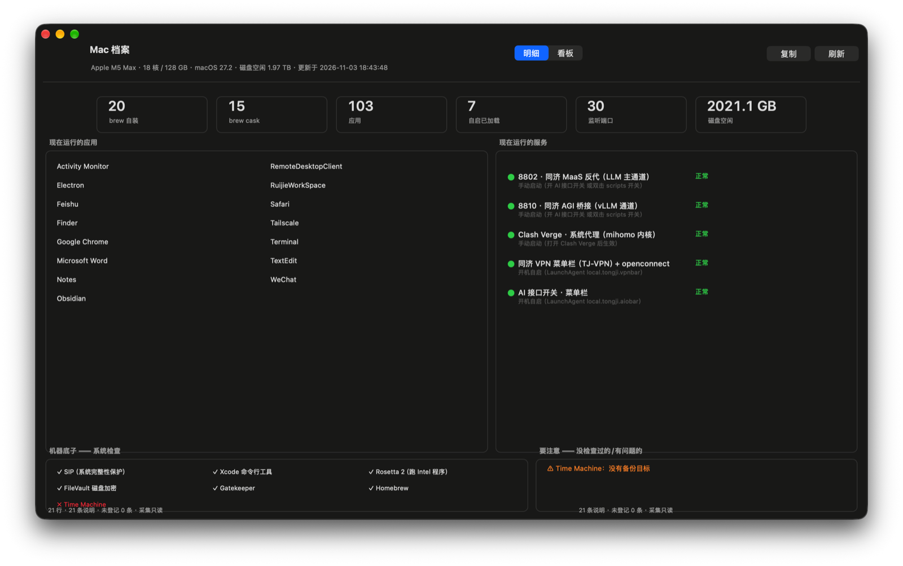

<div align="center">

# Mac 档案 · Mac Dossier

**A native dashboard that answers "what's on my Mac, why it's there, and is it OK right now."**

[](#) [](#) [](#) [](LICENSE)

</div>

<p align="center">
  
</p>

macOS tells you *nothing* about your own machine beyond "About This Mac". `brew list`
counts bottles; Finder shows folders. Neither can tell you **why you installed something,
how to start it again, or that the backup you thought you had was never configured.**

Mac Dossier keeps three layers apart and stitches them into one window:

| Layer | File | Answers |
|---|---|---|
| **Facts** | `collect/collect.py` (read-only) | what is installed / running / listening / on disk |
| **Notes** | `notes/inventory-notes.json` *(yours, git-ignored)* | why it's there, how to run & stop it |
| **Drift** | renderer cross-check | things on the machine that were never registered to notes |

Anything the scanner finds but nobody wrote a note for shows up in the
**私有凭据及未登记** tab — so the documentation cannot silently rot.

## What you get

- **8-tab native window** (Swift/AppKit, no Xcode project — plain `swiftc`):
  all entries → installed software (brew + apps merged) → CLI commands →
  what's running (ports) → login/LaunchAgents → system capabilities →
  directory usage → credentials & unregistered-drift
- **Dashboard mode**: running apps · running services (with ● 正常 / ● 异常 dots,
  auto-start noted in-line) · compact system-check strip · ⚠ warnings
- **Health probes, not port checks**: an actual `GET /health` against your local
  services, TCP handshakes for proxies — listening ≠ alive
- **Brewfile snapshot** on every run: diff against last time answers
  "what did I install since?"
- **User-language status**: green dot + 正常 — no `[OK]`, no probe jargon
- **Read-only collector** with per-command timeouts; SSH keys shown as
  fingerprints only

## Quick start

```bash
git clone https://github.com/<you>/mac-dossier.git
cd mac-dossier

# 1) collect facts → render view → build & open the app (first run compiles it)
./mac-inventory
```

After that, open the **Mac档案** app like any other app (a desktop alias works
great). Refresh data with `⌘R`; to re-collect, run `./mac-inventory` again.

### Write your own notes

Copy the sample and edit it — this file is the actual product; the scanner
can't know *why* you installed things:

```bash
cp notes/inventory-notes.example.json notes/inventory-notes.json
$EDITOR notes/inventory-notes.json
./mac-inventory --render-only   # notes changes don't need a re-collect
```

Each entry declares probes that the renderer turns into live status:

```json
{ "id": "api-gateway", "group": "服务与自启",
  "title": "本地 API 网关",
  "what": "把上游 API 包成 OpenAI 协议的本地反代。",
  "run": ["make up"],
  "status": ["port:11434", "probe:11434"],
  "startmode": "手动启动（make up）" }
```

Probes: `port:` · `probe:` (HTTP /health) · `launchd:` · `dir:` · `cmd:` ·
`brew:` · `app:` — unresolved mixtures degrade gracefully to ◐ 部分未检查.

## How it fits together

```
collect/collect.py   ──只读──▶  ~/.cache/mac-inventory/inventory.json
                                   │
notes/*.json  ───────────────▶  render/render.py
                                   │
                     inventory-view.json ──▶  AppKit window
```

- Collector ~40 s, everything time-boxed; nothing is installed, no sudo
- Renderer merges facts + notes, computes status words and the drift list
- Viewer only displays the merged JSON — data and UI never tangle

## Compared to what already exists

| Tool | What it does | What it doesn't |
|---|---|---|
| fastfetch / neofetch | hardware summary in terminal | nothing about what you installed |
| osquery | SQL over system facts | no human "why", enterprise flavor |
| Homepage / Dashy | dashboards for web services | not for local installs |
| Snipe-IT / GLPI | enterprise asset DB | vastly heavy for one laptop |
| dotfiles / Brewfile | reprovision a new machine | a snapshot to replay, not a live view |

Mac Dossier sits in the gap: **a living, self-checking inventory of one machine,
written by and for its owner.**

## Project layout

```
mac-inventory/
├── mac-inventory            CLI entry: collect → render → open app
├── collect/collect.py        read-only fact collector (brew/apps/launchd/lsof/…)
├── render/render.py          facts + notes → view JSON + markdown
├── app/                     Swift/AppKit viewer; ./build.sh (swiftc only)
│   ├── MacInventoryApp.swift
│   ├── build.sh             builds Mac档案.app, ad-hoc signed
│   └── make-icon.sh         regenerates the app icon
├── notes/
│   ├── inventory-notes.example.json   sample — copy & edit your own
│   └── (inventory-notes.json          yours, git-ignored)
├── docs/DESIGN.md            design notes & pitfalls (AppKit, PS, encoding…)
└── .github/workflows/        CI: build & attach the .app to releases
```

## Requirements

macOS 13+ (developed on 27.2 / arm64), Command Line Tools only — no full
Xcode, no Swift Package Manager, no third-party dependencies.
Python 3.10+ from anywhere (brew's is fine). CLT must be current enough that
`swiftc -O` works.

## Known rough edges

- The viewer is hand-laid-out AppKit (frame math, not Auto Layout) — see
  `docs/DESIGN.md` for why; resizing to extreme sizes cramps columns
- The UI is Chinese-first (this author's daily language); all strings live in
  the renderer/view JSON, so translating is a data change, not a code change
- Everything is time-boxed, so a very slow disk can report `partial` sizes
  (marked, always under-estimates)

## License

[MIT](LICENSE) — facts stay on your machine, notes belong to you.
