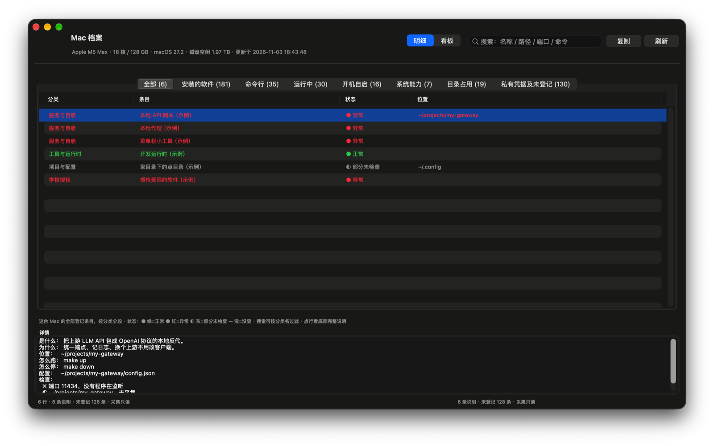
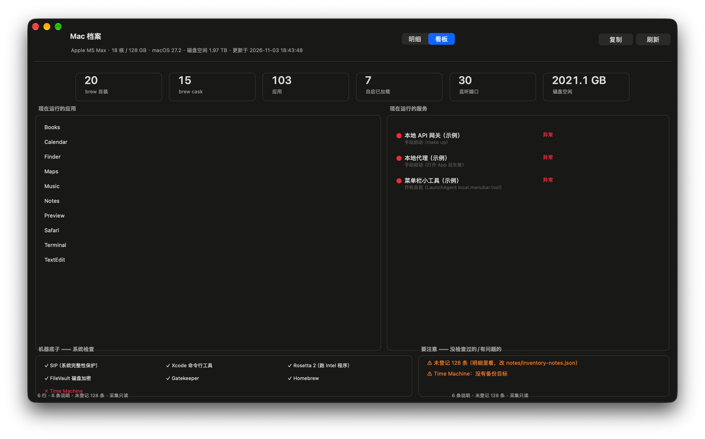

<div align="center">

# Mac 档案

**一个原生窗口看这台 Mac：装了什么、为什么装、现在还好吗。**

[](#) [](LICENSE)

</div>

<p align="center">
  
</p>

**明细**是主窗口：八个标签逐层展开，每行实时探活
（● 正常 / ● 异常 / ◐ 部分未检查），底部联着这条的完整说明。

macOS 对"你的机器"只肯给一个"关于本机"。`brew list` 只数瓶子，Finder 只给文件夹——
没有一个地方能回答：**这东西当初为什么装？再起一次怎么起？你以为配好的备份其实从没配置过？**

Mac 档案把这件事拆成三层缝进一个窗口：

| 层 | 文件 | 回答 |
|---|---|---|
| **事实** | `collect/collect.py`（只读） | 装了什么 / 什么在跑 / 听什么端口 / 占多少盘 |
| **说明** | `notes/inventory-notes.json`（你的，git-ignore） | 为什么装、怎么跑、怎么停 |
| **漂移** | 渲染器对账 | 机器上出现了、说明里没写的东西 |

扫描器发现但没人登记过的东西，会落在「私有凭据及未登记」标签里——
**说明文档烂没烂，机器说了算。**

## 功能

- **8 标签原生窗口**（Swift/AppKit，swiftc 直编无需 Xcode 工程）：
  全部归总 → 安装的软件（brew+应用合一表）→ 命令行 → 运行中（端口/进程）
  → 开机自启（launchd）→ 系统能力 → 目录占用 → 凭据与未登记
- **看板模式**：运行的应用 · 运行的服务（● 正常/异常 + 括号注明自启/手动）·
  机器底子窄带 · ⚠ 要注意
- **真探活**：对本地服务发真实 `GET /health`，代理做 TCP 握手——端口在听 ≠ 服务能用
- **Brewfile 快照**：每次采集 diff 上次，回答"上次登记之后我装了啥"
- **用户语言**：绿点 + 正常，不再有 `[OK]` 和探针黑话
- **只读采集**：外部命令全部带超时；SSH 私钥只显示指纹

**看板**回答"这台机器现在怎么样"——运行的应用、运行的服务（自启/手动就地括号注明）、
机器底子窄带与 ⚠ 提醒：

<p align="center">
  
</p>

## 上手

```bash
git clone https://github.com/<you>/mac-dossier.git && cd mac-dossier
./mac-inventory        # 采集 → 渲染 → 编译并打开窗口（首次约 1 分钟）
```

之后像普通 App 一样打开「Mac档案」即可；`⌘R` 刷新数据，重采集跑 `./mac-inventory`。

**写自己的说明层**（这个文件才是本体；扫描器猜不出"为什么"）：

```bash
cp notes/inventory-notes.example.json notes/inventory-notes.json
$EDITOR notes/inventory-notes.json
./mac-inventory --render-only
```

每条说明声明探针，渲染器把它们折成实时状态：

```json
{ "id": "api-gateway", "group": "服务与自启",
  "title": "本地 API 网关",
  "what": "把上游 API 包成 OpenAI 协议的本地反代。",
  "run": ["make up"],
  "status": ["port:11434", "probe:11434"],
  "startmode": "手动启动（make up）" }
```

## 工作原理

```
collect/collect.py ──只读──▶ ~/.cache/mac-inventory/inventory.json
                                 │
notes/*.json ─────────────▶ render/render.py
                                 │
                   inventory-view.json ──▶ AppKit 窗口
```

内容与界面彻底分离：改说明不用碰 Swift，改外观不用碰 Python。

## 与既有工具的差异

| 工具 | 它管什么 | 它不管什么 |
|---|---|---|
| fastfetch / neofetch | 终端硬件摘要 | 不说装了什么 |
| osquery | SQL 查系统事实 | 没有人的"为什么"，企业味 |
| Homepage / Dashy | Web 服务面板 | 不管本地装机 |
| Snipe-IT / GLPI | 企业资产台账 | 一台笔记本用它是杀鸡用牛刀 |
| dotfiles / Brewfile | 复现新机器 | 是待重放的快照，不是活的视图 |

Mac 档案占的空档：**一台机器的、由主人自己写的、会自我对账的活档案。**

## 结构 / 许可

见 [README.md](README.md#project-layout)（英文主文档，含结构树与已知毛边）。
[MIT](LICENSE) —— 事实留在你机器上，说明归你。
